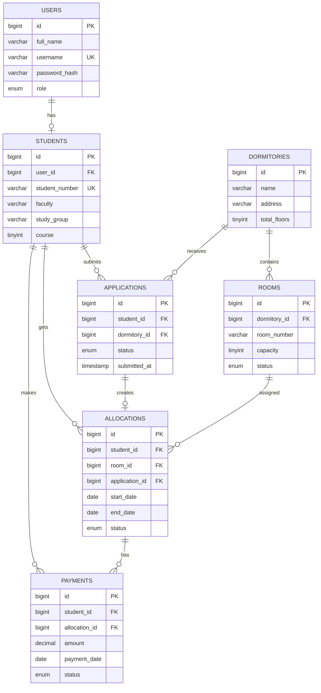

# 05. Тарҳрезии базаи маълумот (Database Design)

## 1. Мақсад

Базаи маълумоти системаи идоракунии хобгоҳи донишҷӯён (SDMS) барои нигоҳдорӣ ва идоракунии маълумоти истифодабарандагон, донишҷӯён, хобгоҳҳо, ҳуҷраҳо, дархостҳо, ҷойгиркунӣ ва пардохтҳо истифода мешавад.

**Системаи идоракунии базаи маълумот:** MySQL

## 2. Ҷадвалҳои асосӣ

### 2.1. `users` — истифодабарандагон

| Майдон | Навъи маълумот | Маҳдудият | Тавсиф |
|---|---|---|---|
| id | BIGINT | PK, AUTO_INCREMENT | Рақами истифодабаранда |
| full_name | VARCHAR(150) | NOT NULL | Ному насаб |
| username | VARCHAR(80) | UNIQUE, NOT NULL | Номи корбар |
| email | VARCHAR(150) | UNIQUE, NULL | Почтаи электронӣ |
| password_hash | VARCHAR(255) | NOT NULL | Пароли рамзгузоришуда |
| role | ENUM | NOT NULL | admin, manager, student |
| phone | VARCHAR(25) | NULL | Рақами телефон |
| created_at | TIMESTAMP | DEFAULT CURRENT_TIMESTAMP | Санаи сабт |

### 2.2. `students` — донишҷӯён

| Майдон | Навъи маълумот | Маҳдудият | Тавсиф |
|---|---|---|---|
| id | BIGINT | PK, AUTO_INCREMENT | Рақами донишҷӯ |
| user_id | BIGINT | FK, UNIQUE | Пайванд ба users |
| student_number | VARCHAR(40) | UNIQUE, NOT NULL | Рақами донишҷӯӣ |
| faculty | VARCHAR(120) | NOT NULL | Факултет |
| study_group | VARCHAR(50) | NOT NULL | Гурӯҳи таълимӣ |
| course | TINYINT | NOT NULL | Курси таҳсил |
| birth_date | DATE | NULL | Санаи таваллуд |

### 2.3. `dormitories` — хобгоҳҳо

| Майдон | Навъи маълумот | Маҳдудият | Тавсиф |
|---|---|---|---|
| id | BIGINT | PK, AUTO_INCREMENT | Рақами хобгоҳ |
| name | VARCHAR(120) | NOT NULL | Номи хобгоҳ |
| address | VARCHAR(255) | NOT NULL | Суроға |
| total_floors | TINYINT UNSIGNED | NOT NULL | Шумораи ошёнаҳо |
| description | TEXT | NULL | Маълумоти иловагӣ |

### 2.4. `rooms` — ҳуҷраҳо

| Майдон | Навъи маълумот | Маҳдудият | Тавсиф |
|---|---|---|---|
| id | BIGINT | PK, AUTO_INCREMENT | Рақами ҳуҷра |
| dormitory_id | BIGINT | FK, NOT NULL | Хобгоҳи дахлдор |
| room_number | VARCHAR(20) | NOT NULL | Рақами ҳуҷра |
| floor | TINYINT UNSIGNED | NOT NULL | Ошёна |
| capacity | TINYINT UNSIGNED | NOT NULL | Ғунҷоиши ҳуҷра |
| status | ENUM | NOT NULL | available, full, maintenance |

Маҳдудияти иловагӣ: ҷуфти `dormitory_id` ва `room_number` бояд ягона бошад.

### 2.5. `applications` — дархостҳо

| Майдон | Навъи маълумот | Маҳдудият | Тавсиф |
|---|---|---|---|
| id | BIGINT | PK, AUTO_INCREMENT | Рақами дархост |
| student_id | BIGINT | FK, NOT NULL | Донишҷӯи дархосткунанда |
| dormitory_id | BIGINT | FK, NOT NULL | Хобгоҳи интихобшуда |
| submitted_at | TIMESTAMP | DEFAULT CURRENT_TIMESTAMP | Санаи дархост |
| status | ENUM | NOT NULL | pending, approved, rejected |
| comment | TEXT | NULL | Шарҳи мудир |

### 2.6. `allocations` — ҷойгиркунии донишҷӯён

| Майдон | Навъи маълумот | Маҳдудият | Тавсиф |
|---|---|---|---|
| id | BIGINT | PK, AUTO_INCREMENT | Рақами ҷойгиркунӣ |
| student_id | BIGINT | FK, NOT NULL | Донишҷӯ |
| room_id | BIGINT | FK, NOT NULL | Ҳуҷраи таъиншуда |
| application_id | BIGINT | FK, UNIQUE, NOT NULL | Дархости тасдиқшуда |
| start_date | DATE | NOT NULL | Санаи ҷойгиршавӣ |
| end_date | DATE | NULL | Санаи хориҷшавӣ |
| status | ENUM | NOT NULL | active, completed, cancelled |

### 2.7. `payments` — пардохтҳо

| Майдон | Навъи маълумот | Маҳдудият | Тавсиф |
|---|---|---|---|
| id | BIGINT | PK, AUTO_INCREMENT | Рақами пардохт |
| student_id | BIGINT | FK, NOT NULL | Донишҷӯ |
| allocation_id | BIGINT | FK, NULL | Ҷойгиркунии вобаста |
| amount | DECIMAL(10,2) | NOT NULL | Маблағи пардохт |
| payment_date | DATE | NOT NULL | Санаи пардохт |
| payment_period | VARCHAR(30) | NULL | Давраи пардохт |
| status | ENUM | NOT NULL | pending, paid, overdue |
| payment_method | VARCHAR(40) | NULL | Усули пардохт |

## 3. Робитаҳои байни ҷадвалҳо

- `users` 1 — 0..1 `students`: ҳисоби корбар метавонад профили донишҷӯ дошта бошад.
- `dormitories` 1 — N `rooms`: як хобгоҳ дорои якчанд ҳуҷра мебошад.
- `students` 1 — N `applications`: донишҷӯ метавонад якчанд дархост пешниҳод кунад.
- `dormitories` 1 — N `applications`: барои як хобгоҳ дархостҳои зиёд пешниҳод мешаванд.
- `students` 1 — N `allocations`: таърихи ҷойгиркунии донишҷӯ нигоҳ дошта мешавад.
- `rooms` 1 — N `allocations`: як ҳуҷра дар давраҳои гуногун метавонад ба донишҷӯёни гуногун дода шавад.
- `applications` 1 — 0..1 `allocations`: дархости тасдиқшуда метавонад ба як ҷойгиркунӣ оварда расонад.
- `students` 1 — N `payments`: донишҷӯ метавонад якчанд пардохт дошта бошад.
- `allocations` 1 — N `payments`: пардохтҳо метавонанд ба ҷойгиркунии муайян вобаста бошанд.

## 4. Қоидаҳои муҳим

1. Парол дар базаи маълумот танҳо дар шакли hash нигоҳ дошта мешавад; пароли аслӣ сабт намешавад.
2. `username`, `email` ва `student_number` бояд ягона бошанд.
3. Пеш аз тасдиқи дархост система бояд мавҷудияти ҷойи холиро санҷад.
4. Шумораи донишҷӯёни фаъол дар ҳуҷра набояд аз `capacity` зиёд бошад. Ин қоида бояд дар транзаксияи базаи маълумот ё мантиқи backend назорат карда шавад.
5. Ҳангоми ҷойгиркунии нав, ҳолати дархост ба `approved` ва ҳолати ҷойгиркунӣ ба `active` гузошта мешавад.
6. Ҳангоми хориҷ шудани донишҷӯ, `end_date` пур карда шуда, ҳолати ҷойгиркунӣ `completed` мешавад.
7. Барои амалиёти ҷойгиркунӣ ва пардохт транзаксия истифода бурдан тавсия мешавад.

## 5. Индексҳо ва маҳдудиятҳо

- Калиди аввалия (`PRIMARY KEY`) барои `id`-и ҳамаи ҷадвалҳо.
- Калидҳои хориҷӣ (`FOREIGN KEY`) барои ҳамаи робитаҳои муайяншуда.
- `UNIQUE` барои `users.username`, `users.email`, `students.user_id`, `students.student_number`.
- `UNIQUE (dormitory_id, room_number)` дар ҷадвали `rooms`.
- Индексҳо барои `applications.status`, `applications.student_id`, `allocations.room_id`, `payments.student_id` ва `payments.status`.

## 6. Диаграммаи робитаҳои ҷадвалҳо (ERD)

## 7. Хулоса

Базаи маълумоти пешниҳодшуда маълумоти асосии системаи идоракунии хобгоҳи донишҷӯёнро ба таври сохторӣ нигоҳ медорад. Ҷудо кардани маълумот ба ҷадвалҳои алоҳида такроршавии маълумотро кам карда, идоракунӣ, ҷустуҷӯ ва ҳисоботдиҳиро осон мекунад. Ин сохтор барои татбиқи backend бо Go ва пайвастшавӣ ба MySQL замина фароҳам меорад.

**Эзоҳ:** Ин тарҳи ибтидоии мантиқӣ мебошад. Ҳангоми татбиқи воқеӣ маҳдудиятҳо ва қоидаҳои тиҷоратӣ дар backend ва базаи маълумот санҷида мешаванд.
